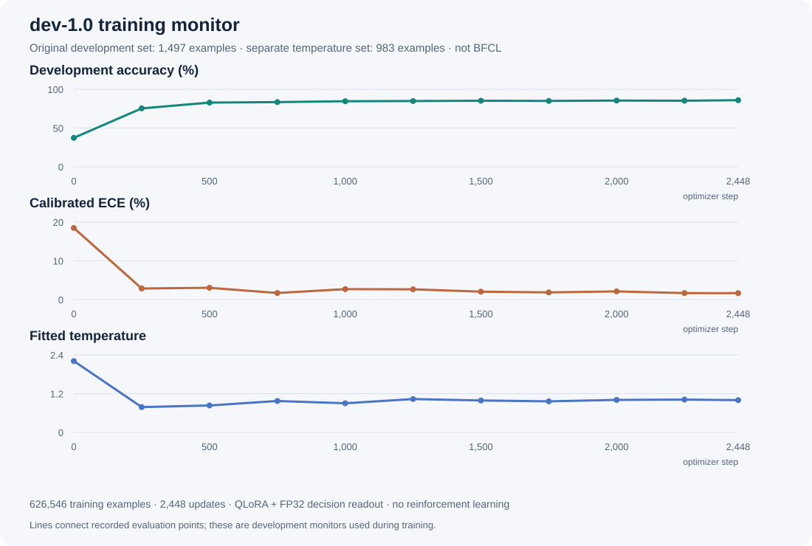

# dev-1.0 训练过程与监测

dev-1.0 使用固定 Qwen3.5-0.8B-Base 进行 1 epoch 监督式 QLoRA 训练，完成 2,448 次 optimizer updates，读取 626,546 条记录。训练监测显示，原开发集准确率由 **37.34%** 提高至 **85.91%**，校准 ECE 由 **18.48%** 降至 **1.65%**。这些指标来自 1,497 条开发记录，**不是 BFCL 基准分数或 BFCL 训练曲线**。

## 训练与选模流程

1. 固定 Base revision、训练记录顺序、模板、源码及环境身份，验证 NF4 量化、图文输入、8K 容量和 checkpoint 保存重载。
2. 在未训练的 adapter 和初始化 readout 上评估原开发集，用 983 条独立温度记录拟合初始温度。开发集和温度集都不参与梯度更新。
3. 使用 soft-label cross entropy 与候选置换增强，更新 rank 8 的语言 all-linear LoRA 和独立 FP32 readout；其他权重冻结。
4. 每次更新处理 effective batch 256，先在该更新内按长度稳定排序，再按真实 padded tokens 拆分 microbatch。训练不 packing、不截断。
5. 定期用同一温度集重新拟合温度，在原开发集评估 raw 和 calibrated 指标，按既定校准门槛与开发选择规则保存 best。
6. step 2,448 完成整轮；best、latest 和 final 指向同一已完成 checkpoint。保存的温度为 `0.9982566635954637`。BFCL 后续评估使用该冻结 checkpoint，没有用 BFCL 标签调整温度、提示或选择模型。

## 全部开发评估点

准确率对 raw 和 calibrated 输出相同，温度缩放不改变最高概率选项。下表 ECE、Brier 和 NLL 均为温度校准后的开发指标；温度在独立 temperature split 上拟合。

| Step | 开发准确率 | 校准 ECE | 校准 Brier | 校准 NLL | 温度 | 更新 best |
| ---: | ---: | ---: | ---: | ---: | ---: | :---: |
| 0 | 37.3413% | 18.4805% | 0.660942 | 1.219107 | 2.209143559 | 是 |
| 250 | 75.3507% | 2.8589% | 0.330339 | 0.581846 | 0.783378387 | 是 |
| 500 | 82.8323% | 3.0372% | 0.248188 | 0.452981 | 0.833619145 | 是 |
| 750 | 83.4335% | 1.6944% | 0.232788 | 0.422192 | 0.972037503 | 是 |
| 1,000 | 84.5691% | 2.6921% | 0.223002 | 0.412082 | 0.901667168 | 是 |
| 1,250 | 84.8363% | 2.6437% | 0.214375 | 0.395319 | 1.032266257 | 是 |
| 1,500 | 85.1703% | 2.0397% | 0.213579 | 0.396439 | 0.987872486 | 是 |
| 1,750 | 84.9699% | 1.8522% | 0.216461 | 0.400193 | 0.961557711 | 否 |
| 2,000 | 85.4375% | 2.1071% | 0.206336 | 0.382437 | 1.005803923 | 是 |
| 2,250 | 85.2371% | 1.6698% | 0.208687 | 0.385632 | 1.015530685 | 否 |
| 2,448 | 85.9051% | 1.6525% | 0.205735 | 0.381197 | 0.998256664 | 是 |

曲线只连接实际记录的 11 个评估点。开发集用于训练过程监测和 checkpoint 选择，不能当作独立测试成绩；BFCL 对照见 [BFCL 报告](bfcl-report.md)。

## 更新与资源记录

| 项目 | 实测记录 |
| --- | --- |
| 实际记录的训练更新 | 2,448 |
| 总处理样本 | 626,546 |
| 总 input tokens | 236,522,274 |
| 首次更新 loss | 1.368392467（256 条） |
| 最后更新 loss | 0.534964643（114 条） |
| 更新耗时求和 | 25161.287 秒 |
| 完整时段 | 2026-10-13 14:42:42.746688 至 21:49:43.515838，Asia/Shanghai |
| 完整时长 | 25,620.769 秒，约 7 小时 7 分钟，含初始及定期评估 |
| GPU peak allocated | 7,057,114,112 bytes（6.57 GiB） |

首尾 loss 分别是两个不同更新的训练 batch loss，样本数量和内容不同，不能当作整轮平均损失或独立泛化指标。此处没有为中间未提供的 loss 点补值或生成平滑曲线。

## GPU 功耗

训练在单张 H200 NVL 上运行，硬件功耗上限保持 280W。训练窗口共有 **5,074** 个采样：均值 **268.11W**、峰值 **290.66W**，超过 300W 的样本数为 **0**；requested 与 enforced limit 的采样均为 280W。功耗瞬时读数可能高于配置上限。

采样覆盖共享 GPU，包含同卡服务，不是训练进程独占功耗，也不是整机插座功耗；离散采样不证明所有未采样瞬间都低于 300W。

## 数值与复现身份

实际 LoRA 参数 5,411,328 个，readout 参数 261,120 个，合计 5,672,448 个可训练参数。训练与保存的这些参数为 FP32；冻结的文本线性权重使用 NF4，计算使用 BF16，视觉塔和 embedding 冻结。

本页所有训练与开发数值提取自原 run 的冻结事件汇总，源汇总文件 SHA256 为 `713b554a2a38afcbb1348f0aea03c363b8ec85744a305f99cf30d07e4f4f4f23`。训练器 SHA256 为 `d1a4e6bcf6a98ed71c470b84036fe49f053997dd586acb4d8c7ecc9c1747c872`；源码与依赖身份见仓库 `provenance/`。

图文样本与受测设备上的恢复验证不能承诺跨硬件、跨版本的完整 bitwise 一致。不同数据子集、Base 文件或量化环境应作为新的复现实验记录。
